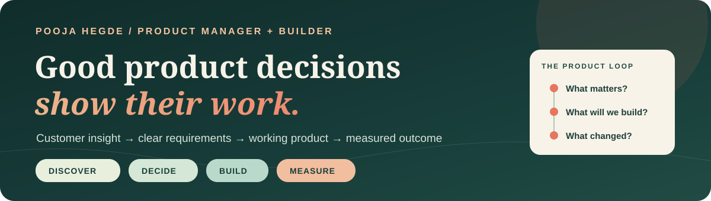

<div align="center">



### Product Manager · Customer insight to launch · Builder

I turn ambiguous customer problems into clear product decisions, working prototypes, and measurable experiments.

[Portfolio](https://poojahegdeportfolio.netlify.app/) · [LinkedIn](https://www.linkedin.com/in/poojahegde998p/) · [Email](mailto:poojagh1298@gmail.com)

</div>

---

### What you'll find here

I work across customer discovery, product strategy, experimentation, and delivery. My public projects make the reasoning visible: the user problem, the tradeoffs, the requirements, the prototype, and the evidence that would change a launch decision.

|  |  |
| --- | --- |
| **[Confidence Gate](https://github.com/Poojaahegde/confidence-gate)**<br>AI support copilot review flow that surfaces evidence and sends uncertain or policy-sensitive claims to a human.<br>[Try the prototype](https://poojaahegde.github.io/confidence-gate/) · [Read the experiment](https://github.com/Poojaahegde/confidence-gate/blob/master/docs/EXPERIMENT_READOUT.md)<br><sub>AI product · evaluation · trust</sub> | **[Trust-First Retention](https://github.com/Poojaahegde/trust-first-retention)**<br>A cancellation experience designed around voluntary retention, clear customer choice, and measurable guardrails.<br>[Explore the decision lab](https://poojaahegde.github.io/trust-first-retention/) · [Read the PRD](https://github.com/Poojaahegde/trust-first-retention/blob/master/docs/PRD_REDACTED.md)<br><sub>Growth · experimentation · product requirements</sub> |
| **[Signal to Roadmap](https://github.com/Poojaahegde/signal-to-roadmap)**<br>Turn fragmented customer feedback into traceable issues and a draft roadmap.<br>[Try the dashboard](https://poojahegdeportfolio.netlify.app/apps/signal-to-roadmap/) · [Read the method](https://github.com/Poojaahegde/signal-to-roadmap/blob/master/README.md)<br><sub>Discovery · synthesis · prioritization</sub> | **[Launch Ledger](https://github.com/Poojaahegde/launch-ledger)**<br>Weigh activation, support, performance, and rollback readiness before expanding a pilot.<br>[Try the decision lab](https://poojaahegde.github.io/launch-ledger/) · [Read the PRD](https://github.com/Poojaahegde/launch-ledger/blob/master/PRD.md)<br><sub>Release strategy · guardrails · decision records</sub> |

> **Evidence note:** These are independent portfolio builds. Where a case study uses fictional context, synthetic data, or a simulated experiment, its repository says so explicitly. They do not represent production customer outcomes.

### How I make product decisions

```text
Observe the workflow → Find the friction → State the tradeoff →
Write the product contract → Build to learn → Measure → Decide
```

- **Start with the customer.** Separate the underlying problem from the first solution requested.
- **Write for delivery.** Define non-goals, acceptance criteria, failure states, and ownership.
- **Measure before launch.** Specify the population, success metric, guardrails, and decision threshold.
- **Use AI with judgment.** Make sources, uncertainty, escalation, and human review visible.

### More things I've built

[MBA Decision Lab](https://github.com/Poojaahegde/mba-decision-lab) · [Hypothesis Studio AI](https://github.com/Poojaahegde/hypothesis-studio-ai) · [PriorityLens](https://github.com/Poojaahegde/prioritylens) · [ScopeCreep](https://github.com/Poojaahegde/scopecreep) · [Smart Onboarding Analyzer](https://github.com/Poojaahegde/smart-onboarding-analyzer)

### Product craft and tools

`Customer discovery` `PRDs` `Roadmaps` `Acceptance criteria` `A/B testing` `SQL` `Product analytics` `Python` `JavaScript` `AI evaluation`

---

<div align="center">

**Good product decisions show their work.**

[See the portfolio](https://poojahegdeportfolio.netlify.app/) · [Let's connect](https://www.linkedin.com/in/poojahegde998p/)

</div>
